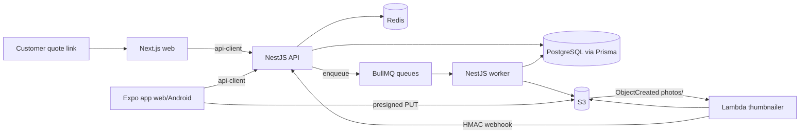

# field-service-saas

[](https://github.com/mini4141/field-service-saas/actions/workflows/ci.yml)

A multi-tenant B2B SaaS for service businesses (cleaning, repairs, installation), written in TypeScript end to end. Office staff quote and schedule jobs in a **Next.js** app, field staff complete jobs and upload photos from an **Expo** app, and invoices and thumbnails are produced asynchronously by **BullMQ** workers and an **AWS Lambda**. One monorepo, deployable to **EKS**.

- Proof of everything working: [`proof/README.md`](proof/README.md)
- Write-up: [`docs/PORTFOLIO.md`](docs/PORTFOLIO.md)
- Engineering notes: [`CONTRIBUTING.md`](CONTRIBUTING.md), [`docs/support-playbook.md`](docs/support-playbook.md), [`docs/adr-001-tenant-scoping-refactor.md`](docs/adr-001-tenant-scoping-refactor.md), [`docs/DECISIONS.md`](docs/DECISIONS.md), [`docs/AI_USAGE.md`](docs/AI_USAGE.md)

## Architecture



| Path | What |
|---|---|
| `apps/api` | NestJS 11 API (auth, customers, quotes, jobs, invoices, uploads, dashboard), OpenAPI at `/api/docs` |
| `apps/worker` | NestJS BullMQ processors: `invoice-pdf`, `notifications`, `kpi-refresh` |
| `apps/web` | Next.js 15 (App Router, server components + server action, TanStack Query) |
| `apps/mobile` | Expo SDK 54 field app, built for web (and Android) |
| `apps/thumbnailer` | Lambda handler (+ local watcher that runs the same handler) |
| `packages/api-client` | typed client generated from OpenAPI (`openapi-typescript` + `openapi-fetch`) |
| `packages/ui`, `packages/config`, `packages/shared` | shared UI, eslint/tsconfig, tenant context + Prisma extension |
| `prisma/` | schema, migrations, seed |
| `deploy/helm`, `infra/` | Helm chart, Terraform (EKS, RDS, ElastiCache, S3, Lambda, CloudFront, ECR) |

## Quickstart (local, no AWS)

Prerequisites: Node 24, pnpm, Docker Desktop.

```bash
pnpm install
scripts/dev-up.sh          # postgres, redis, moto (S3) + api, worker, web, mobile web, thumbnailer watcher
# web    http://localhost:3000    mobile web http://localhost:8081    API docs http://localhost:4000/api/docs
# demo logins: owner@sakura.test / office@sakura.test / ken@sakura.test  (password123)
scripts/test-all.sh        # lint, typecheck, Jest, Nest e2e, Vitest, Playwright (web + Expo web)
scripts/dev-down.sh
scripts/kind-up.sh         # the same services on a kind cluster via the Helm chart + Traefik
```

Demo story: Sakura Cleaning sends a ¥45,000 quote, the customer accepts via `/q/<token>`, the job is dragged onto Ken's calendar, Ken completes it with two photos in the Expo app, thumbnails and the invoice PDF appear, and the owner's dashboard revenue tile updates.

## Deploy / destroy (AWS, from this PC)

```bash
aws sts get-caller-identity --profile field-service-saas-deployer
scripts/deploy.sh               # terraform -> ECR -> Traefik NLB -> Helm -> Expo to S3/CloudFront -> Playwright vs cloud
scripts/destroy.sh              # helm uninstall, delete the NLB, empty buckets, terraform destroy
scripts/verify-destroyed.sh     # exits non-zero if anything billable remains
```

GitHub Actions only builds and tests; it never holds AWS credentials.
