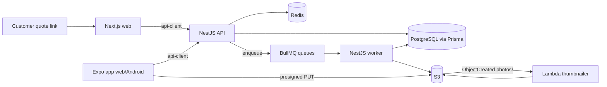

# SPECS.md: Field Service SaaS

## 1. Summary

A **vertical B2B SaaS** for service businesses (cleaning, repairs, installation). It covers the whole job lifecycle:

- A company signs up and invites office and field staff.
- **Office** staff manage customers, build **quotes** with line items and send them. The customer accepts through a public link, which creates a **job**. Staff then schedule the job on a calendar and assign it.
- **Field** staff use the **Expo** app to see today's jobs, check in, upload photos and mark the job complete.
- Completion triggers asynchronous **invoice PDF** generation. Uploaded photos get thumbnails from a **Lambda**. The owner's dashboard shows KPIs cached in Redis.

**Demo story:**
1. Sakura Cleaning sends a ¥45,000 quote, and the customer accepts it.
2. The job is scheduled for Ken.
3. Ken completes it on his phone (Expo web) with two photos.
4. Thumbnails appear and the invoice PDF is ready.
5. The dashboard's revenue tile updates.

## 2. Requirement coverage matrix

| Requirement | Covered by | Proof |
|---|---|---|
| Features end to end (frontend, backend, architecture) | Quote → job → invoice flow across web, API, worker and mobile | e2e tests |
| Technically challenging work: refactoring, complex data modelling, platform integrations | Multi-tenant Prisma extension, quote → job → invoice model, S3/Lambda integration, a refactor ADR | ADR + code |
| Reliability, performance, maintainability | Queues + retries, KPI cache, request-ID tracing, typed client | Logs |
| Mentoring, code-quality standards | `CONTRIBUTING.md`, lint rules, PR template, architecture docs | Repo |
| Support rotations, bugs, incidents | `docs/support-playbook.md` + correlation IDs | Doc |
| TypeScript, React (2y+), backend frameworks, DB modelling (SQL/Prisma), async architecture | All | CI |
| Git, PR reviews, CI/CD, automated tests | GitHub Actions + tests | CI |
| NestJS, Prisma, PostgreSQL, AWS (EKS, S3, Lambda), Redis, Next.js, React Native (Expo) | All | Proof |
| Containers (Docker), cloud infra, AI-assisted dev, B2B SaaS | Docker/EKS, `docs/AI_USAGE.md`, multi-tenant B2B | — |

## 3. Architecture



## 4. Repository layout

```
apps/api/        NestJS (modules: auth, companies, users, customers, quotes, jobs, invoices, uploads, dashboard)
apps/worker/     NestJS standalone app (BullMQ processors)
apps/web/        Next.js
apps/mobile/     Expo app
apps/thumbnailer/  Lambda handler (+ local watcher)
packages/api-client/  packages/ui/  packages/config/
prisma/          schema.prisma, migrations, seed.ts
deploy/helm/field-service/   charts for api, worker, web (+ Traefik values)
infra/           Terraform
turbo.json  pnpm-workspace.yaml
```

## 5. Features (end-to-end)

### F1: Company signup, auth and roles
- Sign up a company and owner, then invite office and field users (the invite link is shown on screen). JWT access token + refresh cookie. Role guard.
- **Accept:** the owner, office and field users each see the right navigation.

### F2: Customers
- CRUD with search; customers have an address and contact.
- **Accept:** create and list.

### F3: Quote builder and public acceptance
- Line items (description, qty, unit price, tax). The total is computed server-side.
- "Send" generates a public token link `/q/<token>`, and the customer clicks Accept, which creates a job (status `unscheduled`).
- **Accept:** a ¥45,000 quote is accepted, and the job exists.

### F4: Scheduling
- A week calendar (Next.js client component) where office staff drag a job onto a day/time and assign a field user (`PATCH /jobs/:id/schedule`).
- **Accept:** the job shows on Ken's "Today" list in the mobile app.

### F5: Field app (Expo)
- Login, the Today list, job detail with the address, a check-in button, a photo picker → presigned upload, notes, and "Complete job".
- **Accept:** the Expo web e2e completes a job with 2 photos.

### F6: Photo thumbnails (Lambda)
- The S3 `photos/<companyId>/<jobId>/<file>` ObjectCreated event triggers the Lambda, which writes `thumbs/...` (320 px) and calls the API webhook (`POST /internal/photos/thumbnail-ready`, HMAC).
- **Accept:** thumbnails render on the web job page.

### F7: Async invoices and notifications
- On `JobCompleted`, the worker renders the invoice PDF (pdfkit) and uploads it to S3. The invoice status becomes `ready`, and a notification is logged ("Email to customer: invoice ready").
- **Accept:** the web invoice page offers a presigned download of a valid PDF.

### F8: Owner dashboard
- KPIs: quotes sent/accepted (conversion %), jobs completed this week, revenue invoiced, and average time from completion to invoice. They're computed by SQL and cached in Redis (TTL 60 s, refreshed by a repeatable job).
- **Accept:** the KPI tiles update after the demo flow.

## 6. Data model (Prisma)

`Company`, `User(role)`, `Customer`, `Quote(status, token, total)`, `QuoteItem`, `Job(status, scheduledAt, assigneeId)`, `JobPhoto(key, thumbKey)`, `Invoice(status, pdfKey, total)` and `AuditLog`. Every model carries `companyId` with composite indexes like `(companyId, status)`.

## 7. Interfaces

- **REST** (`/api/v1`): `auth/*`, `customers`, `quotes` (+ `/:id/send`), `public/quotes/:token` (+ `/accept`), `jobs` (+ `/:id/schedule`, `/:id/checkin`, `/:id/complete`), `uploads/presign`, `invoices/:id/download`, `dashboard/kpis`, `internal/photos/thumbnail-ready`, `healthz`.
- **OpenAPI** at `/api/docs`.

## 8. Test plan

| Layer | Test |
|---|---|
| Jest unit | Quote total; schedule assigns; invoice processor uploads the PDF (S3 mocked) |
| Nest e2e | Full API flow; cross-tenant 404 |
| Lambda | Handler resizes a fixture image |
| Vitest | Web quote editor renders totals; mobile job card |
| Playwright | Office flow (web) + field flow (Expo web) |

## 9. Phase 1: Local

`docker compose` (postgres, redis, moto) + `turbo dev` (api, worker, web, mobile web, thumbnailer watcher). Then a **kind** deployment of api/worker/web using the Helm chart, with compose-like dependencies in-cluster, to prove the K8s packaging.

- [ ] `tests/`: Jest, Vitest, Playwright reports
- [ ] `screenshots/01-signup.png`, `02-quote-builder.png`, `03-public-quote-accept.png`, `04-calendar.png`, `05-mobile-today.png`, `06-mobile-complete-photos.png`, `07-job-thumbnails.png`, `08-invoice-pdf.png`, `09-dashboard-kpis.png`, `10-swagger.png`
- [ ] `logs/worker-invoice.log`, `logs/request-id-trace.log` (one request across web → api → worker), `logs/kind-get-all.txt`

## 10. Phase 2: AWS

| Local | AWS |
|---|---|
| compose Postgres | RDS PostgreSQL |
| compose Redis | ElastiCache Redis (`cache.t4g.micro`) |
| moto S3 + watcher | S3 bucket + event notification → Lambda thumbnailer |
| turbo dev / kind | EKS (api, worker, web) via Helm, Traefik NLB |
| Expo web dev | Expo web static export on S3 + CloudFront |

`scripts/deploy.sh`:
1. `terraform apply`.
2. Push images.
3. `prisma migrate deploy` (K8s Job).
4. `helm upgrade --install`.
5. Seed.
6. Upload the Expo web export.
7. Playwright (web + mobile web) against the cloud URLs.

- [ ] `screenshots/01-eks-dashboard.png`, `02-cf-mobile-complete.png`, `03-eks-thumbnails.png`, `04-eks-invoice.png`
- [ ] `logs/lambda-thumbnailer.log`, `logs/kubectl-eks.txt`, `resources.txt`
- [ ] `tests/playwright-cloud/`

## 11. Phase 3: Destroy

`destroy.sh`:
1. `helm uninstall` and delete the LB Service (wait for the NLB).
2. Empty the S3 buckets.
3. `terraform destroy`.

`verify-destroyed.sh` checks for no EKS cluster, RDS instance, ElastiCache cluster, Lambda, CloudFront distribution or ELBs.

## 12. Out of scope

Payments, SMS/email delivery, offline mobile sync, iOS builds, and SSO.
