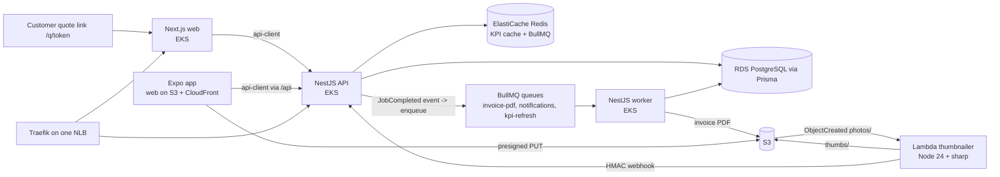
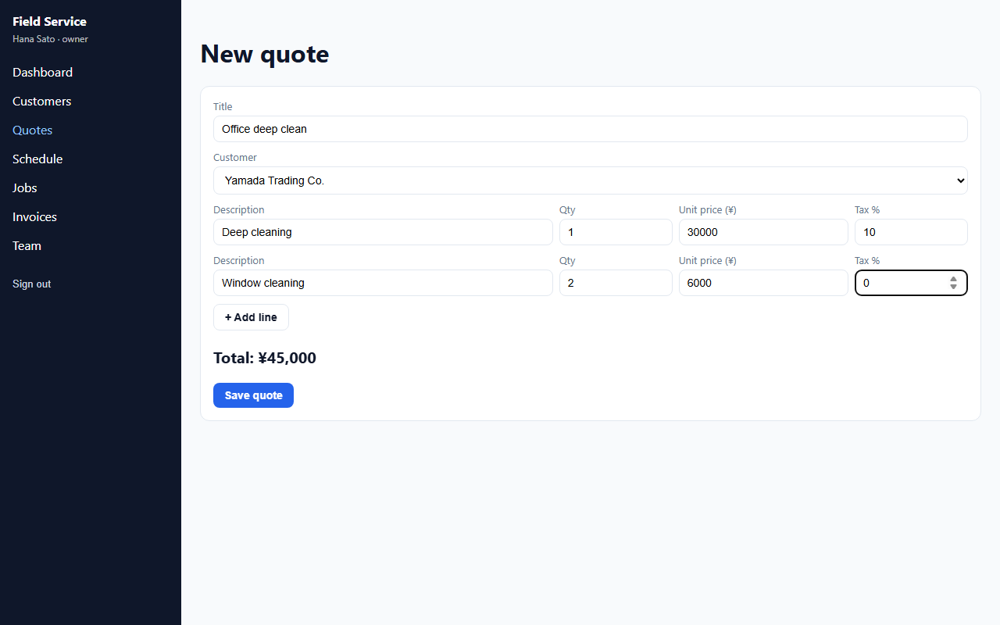
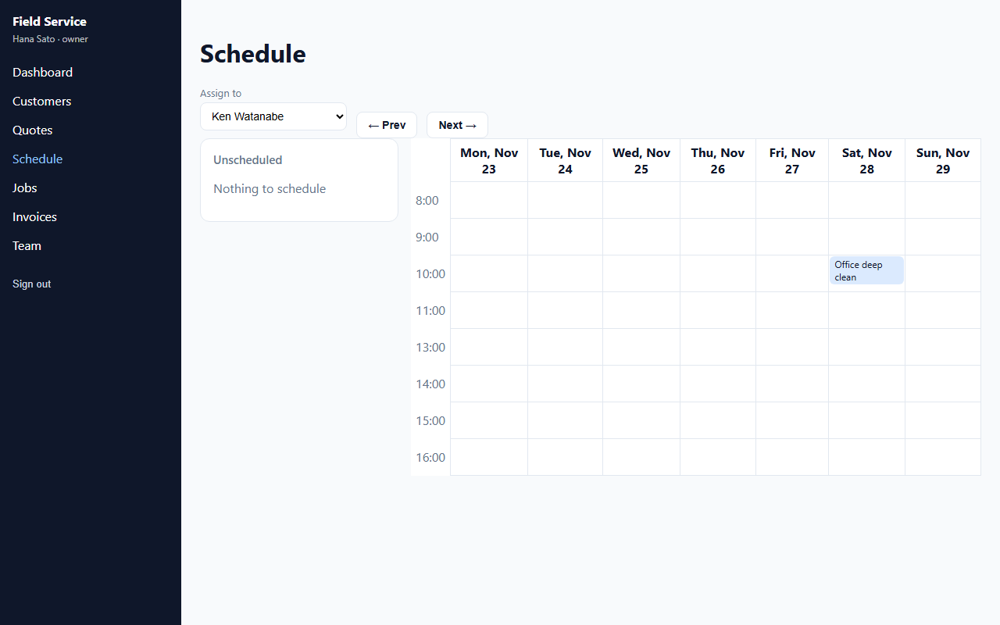
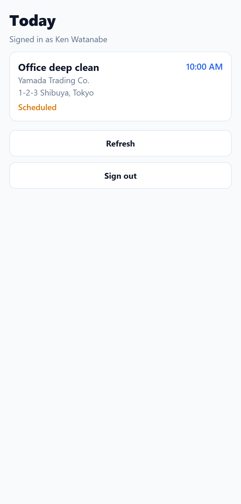
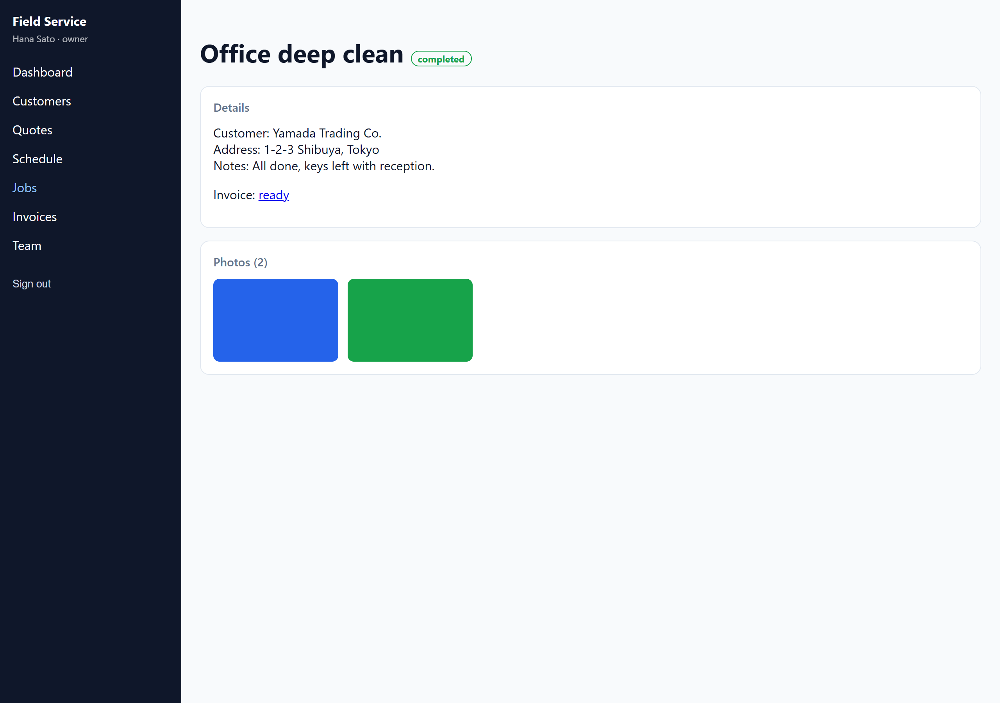
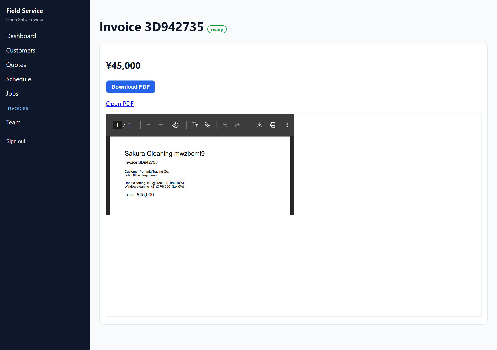
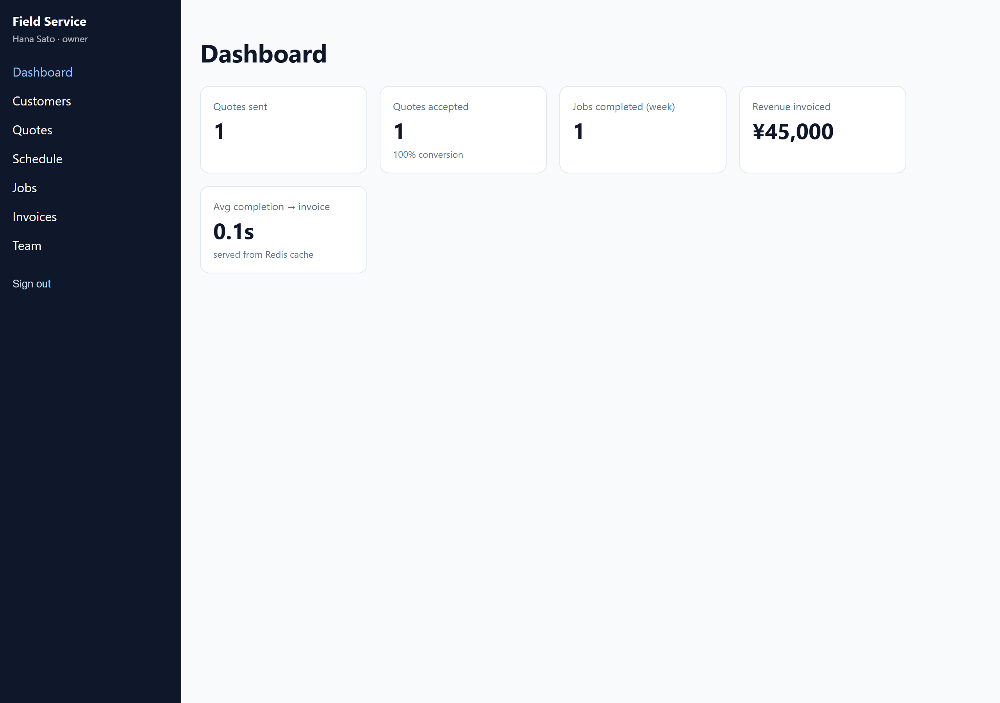
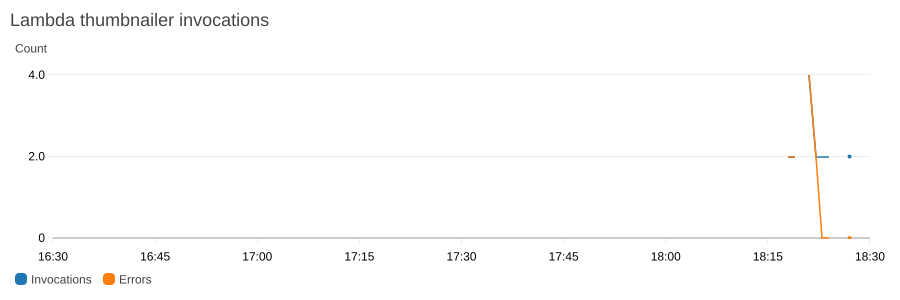

# Field Service SaaS: a TypeScript monorepo from quote to invoice

## The problem

Small service businesses (cleaning, repairs, installation) run on phone calls, spreadsheets and paper. A job passes through four people: the office quotes it, the customer approves it, a field worker does it and documents it, and someone invoices it. Each hand-off loses time. This project is a multi-tenant SaaS that covers that whole lifecycle, built as one TypeScript monorepo and deployed to AWS.

**Demo story (all of it runs in the proof):** Sakura Cleaning sends a ¥45,000 quote. The customer accepts it through a public link, which creates a job. The office drags the job onto Ken's calendar. Ken completes it on his phone with two photos. A Lambda creates thumbnails, a BullMQ worker renders the invoice PDF, and the owner's dashboard revenue tile updates.

## Architecture



## Stack to requirement

| Requirement | Where it lives | Proof |
|---|---|---|
| TypeScript everywhere (strict), pnpm + Turborepo | every app and package | CI, `turbo.json` |
| NestJS 11 (modules, guards, interceptors, validation pipes, OpenAPI) | `apps/api` | `proof/phase1-local/screenshots/10-swagger.png` |
| Prisma + PostgreSQL 17, migrations | `prisma/`, tenant extension in `packages/shared` | cross-tenant 404 e2e, ADR 001 |
| Redis + BullMQ, domain events, cache | `apps/worker`, KPI cache in `apps/api` | `request-id-trace.log`, `worker-invoice.log` |
| React 19 + Next.js 15 (App Router, server component, server action), TanStack Query | `apps/web` | screenshots 01-04, 07-09 |
| React Native (Expo) built for web | `apps/mobile` | `05`, `06`, and `phase2-cloud/screenshots/02-cf-mobile-complete.png` |
| Generated API client | `packages/api-client` (openapi-typescript + openapi-fetch), CI drift check | `.github/workflows/ci.yml` |
| S3 presigned uploads, S3 event to Lambda | `apps/thumbnailer`, `infra/storage.tf` | `phase2-cloud/logs/lambda-thumbnailer.log`, `03-eks-thumbnails.png` |
| Invoice PDFs (pdfkit) in the worker, stored in S3 | `apps/worker/src/invoice.service.ts` | `08-invoice-pdf.png`, `04-eks-invoice.png` |
| Docker, Helm, Amazon EKS (spot) | `Dockerfile`, `deploy/helm`, `infra/eks.tf` | `kind-get-all.txt` (local), `kubectl-eks.txt` (cloud) |
| Terraform, AWS (EKS, ECR, RDS, ElastiCache, S3, Lambda, CloudFront, CloudWatch) | `infra/` | `phase2-cloud/resources.txt`, `05-cloudwatch-lambda.png` |
| Jest, Vitest, Playwright | unit, Supertest e2e, component tests, web + Expo web e2e | `proof/phase1-local/tests/`, `phase2-cloud/tests/playwright-cloud/` |
| GitHub Actions with Turborepo caching | `.github/workflows/ci.yml` | green runs on `main` |
| Support-rotation readiness | `x-request-id` through web, API and worker, structured JSON logs with `companyId` | `docs/support-playbook.md` (three investigated bugs) |

## Key screenshots

| | |
|---|---|
| Quote builder (total computed live, recomputed on the server) |  |
| Calendar (drag a job onto a day and hour) |  |
| Expo field app, today's jobs |  |
| Thumbnails produced by the Lambda on AWS |  |
| Invoice PDF rendered by the worker on EKS |  |
| Owner dashboard served from Redis cache on EKS |  |
| Lambda invocations, rendered with `aws cloudwatch get-metric-widget-image` |  |

## Design decisions worth reading

- **Tenant isolation in one place.** A Prisma client extension injects `companyId` from an `AsyncLocalStorage` context and refuses queries with no tenant ([ADR 001](adr-001-tenant-scoping-refactor.md)).
- **Controllers never do slow work.** `JobCompleted` becomes a BullMQ job; the worker renders the PDF, uploads it, and emits `InvoiceReady`, which becomes a notification job (simulated email). Jobs retry 3 times with exponential backoff.
- **One typed contract.** The API writes `openapi.json` at build time (without needing a database, via Nest preview mode), the client is generated from it, and CI fails on drift.
- **Same handler locally and in Lambda.** Locally a watcher polls moto and runs the exact thumbnail function the Lambda runs.
- **One public endpoint.** Traefik sits behind a single NLB; CloudFront serves the Expo build and proxies `/api/*` to the NLB, so the HTTPS mobile page never makes mixed-content calls. EKS Pod Identity gives pods S3 access without static keys.

## What was hard

- **Lazy Prisma queries vs. async context.** The thumbnail webhook returned 500 because the query ran after the `AsyncLocalStorage` scope had ended; the fix and the lesson are in the support playbook.
- **Lambda packaging from Windows.** `sharp` needs linux-x64 binaries (`npm install --os=linux --cpu=x64 --libc=glibc`), and the handler signature had to ignore Lambda's second `context` argument. Both only showed up on real AWS, through CloudWatch logs.
- **Baked-in build env.** The Expo web build kept `localhost:4000` from a cached Metro transform; the cloud export needs `--clear`.
- **Teardown discipline.** The NLB created by the Traefik service blocks VPC deletion unless it is removed first, so `destroy.sh` deletes it, waits, and only then runs `terraform destroy`. `verify-destroyed.sh` then checks each service directly.

## Cost

The stack lived about two hours: EKS control plane, two spot `t3.medium` nodes, one NLB, `db.t4g.micro`, `cache.t4g.micro`, Lambda, S3, CloudFront (PriceClass_100) and ECR. No NAT gateways. Roughly **USD 1** in total. `proof/phase3-destroy/verify-destroyed.txt` shows nothing billable left.

## Reproduce

```bash
pnpm install
scripts/dev-up.sh && scripts/test-all.sh && scripts/capture-proof.sh phase1   # local, no AWS
scripts/kind-up.sh                                                           # Helm chart on kind
# AWS (profile field-service-saas-deployer, ap-southeast-2)
scripts/deploy.sh          # terraform, ECR, Traefik NLB, Helm, Expo to S3/CloudFront, Playwright vs cloud
scripts/destroy.sh && scripts/verify-destroyed.sh
```
